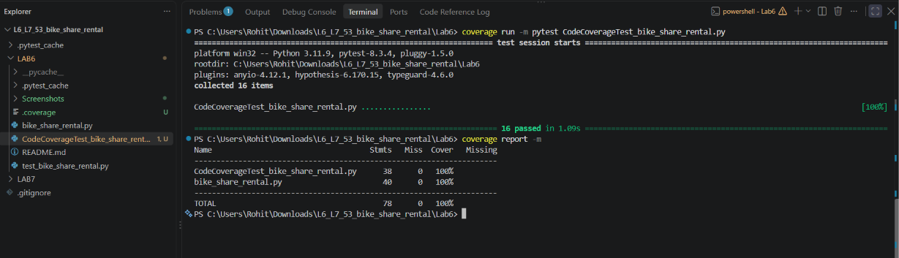
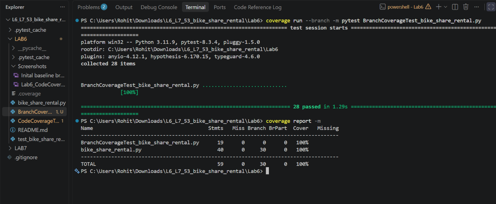

# Lab 6: Code and Branch Coverage Analysis

## About

A small Python module that prices bike-share rides by bike type, duration and subscription, reports dock status and decides whether a rider may unlock a bike.

## Objective

Measure, analyze, and improve line (statement) and branch test coverage for the Bike Share Rental application (`bike_share_rental.py`) using `pytest` and `coverage.py`.


## Files Given

| File | Description |
|------|-------------|
| `bike_share_rental.py` | The module under test |
| `test_bike_share_rental.py` | Starter test file |

## Project Structure
```text
LAB6/
├── bike_share_rental.py                    # Core rental pricing, dock status, and unlock logic
├── test_bike_share_rental.py               # Initial baseline unit tests
├── CodeCoverageTest_bike_share_rental.py   # Expanded test suite achieving 100% line coverage
├── BranchCoverageTest_bike_share_rental.py # Expanded test suite achieving 100% branch coverage
├── Screenshots/
│   ├── Inital baseline branch coverage.png
│   ├── Lab6_CodeCoverage_Report.png
│   └── Lab6_BranchCoverage_Report.png
└── README.md
```

## Setup & Execution
Install the required dependencies:
```bash
pip install pytest coverage
```

### Line Coverage Analysis
```bash
coverage run -m pytest CodeCoverageTest_bike_share_rental.py
coverage report -m
```

### Branch Coverage Analysis
```bash
coverage run --branch -m pytest BranchCoverageTest_bike_share_rental.py
coverage report -m
```

## Coverage Results Summary
| Test Suite | Target Metric | Statements | Missing | Branches | Partial | `bike_share_rental.py` Coverage |
| :--- | :--- | :---: | :---: | :---: | :---: | :---: |
| `test_bike_share_rental.py` (Baseline) | Line Coverage | 40 | 20 | — | — | 50% |
| `CodeCoverageTest_bike_share_rental.py` | Line Coverage | 40 | 0 | — | — | **100%** |
| `BranchCoverageTest_bike_share_rental.py` | Branch Coverage | 40 | 0 | 26 | 0 | **100%** |

## Execution Report & Screenshots

### 1. Baseline Coverage Analysis
Running `coverage` on the initial `test_bike_share_rental.py` resulted in **50% line coverage** (20 out of 40 statements missed across `ride_cost`, `dock_status`, and `can_unlock`) and uncovered conditional branches.


### 2. Code Coverage Analysis (100% Line Coverage)
Added `CodeCoverageTest_bike_share_rental.py` to test every execution statement, including invalid bike types, invalid durations, subscriber discounts, long-ride surcharges, dock capacity thresholds, and age-based unlock conditions.



### 3. Branch Coverage Analysis (100% Branch Coverage)
Added `BranchCoverageTest_bike_share_rental.py` using parameterized boundary and compound boolean tests to verify that every `if`, `elif`, and short-circuiting `and`/`or` condition evaluates to both `True` and `False`.

