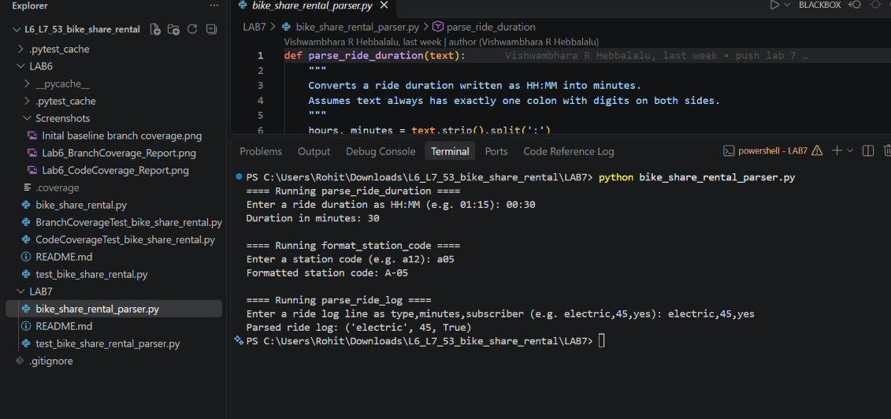
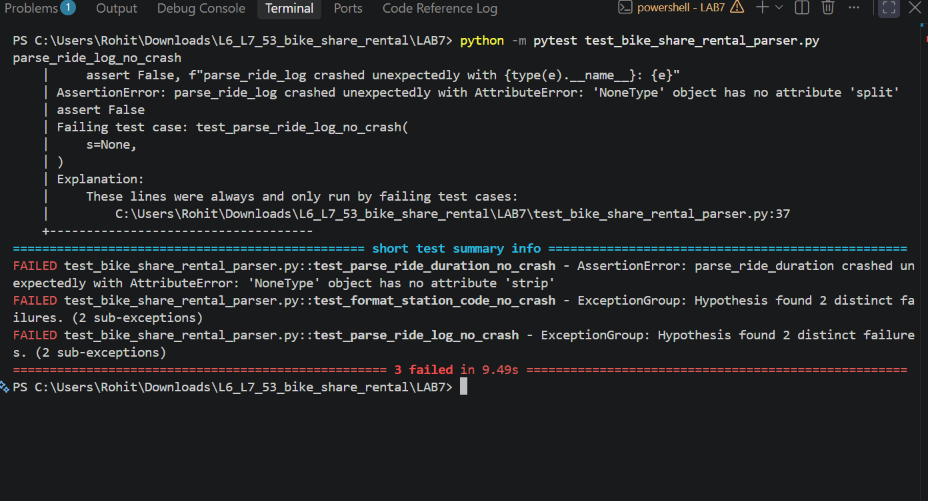
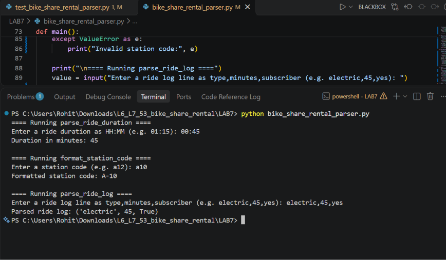
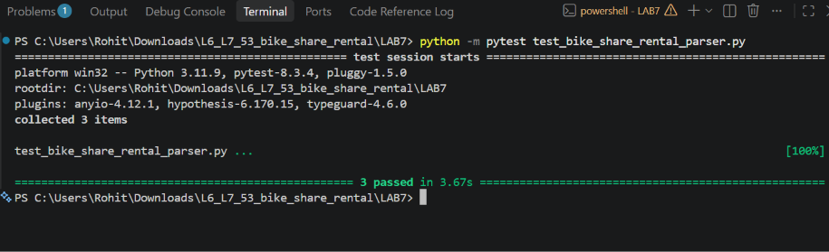

# Lab 7: Fuzzing for Input Validation Bugs

## About
A small Python module that reads bike share rental details typed in by a user: ride durations, station codes and ride log lines. It assumes every input is well formed.

## Objective
Use property-based fuzz testing with the `Hypothesis` library to uncover edge-case input crashes in `bike_share_rental_parser.py` and harden all parsing functions using defensive programming.

## Files

| File | Description |
|------|-------------|
| `bike_share_rental_parser.py` | The buggy module you will fuzz and fix |
| `test_bike_share_rental_parser.py` | Hypothesis test template to complete |

## Project Structure
```text
LAB7/
├── bike_share_rental_parser.py       # Hardened input parser for durations, station codes, and ride logs
├── test_bike_share_rental_parser.py  # Hypothesis property-based fuzz test suite
├── Lab7_FuzzTesting_Report.pdf       # Execution report with terminal screenshots
├── Screenshots/
│   ├── Lab7_1_Buggy_App_Run.png
│   ├── Lab7_2_Fuzz_Tests_Failing.png
│   ├── Lab7_3_Fixed_App_Run.png
│   └── Lab7_4_Fuzz_Tests_Passing.png
└── README.md
```

## Setup & Execution
Install the required dependencies:
```bash
pip install pytest hypothesis
```

### Run the Parser Application
```bash
python bike_share_rental_parser.py
```

### Run Hypothesis Fuzz Tests
```bash
python -m pytest test_bike_share_rental_parser.py
```

## Bugs Discovered & Fixes Applied
| Function | Vulnerabilities Exposed by Fuzzing | Defensive Fix Implemented |
| :--- | :--- | :--- |
| `parse_ride_duration(text)` | Crashed with `AttributeError` on `None`; `ValueError` on missing/multiple colons or non-numeric input; accepted negative values or minutes >= 60. | Enforced `str` type check, exact `HH:MM` colon split, ASCII digit validation, and `0 <= minutes < 60` bounds, raising `ValueError` on invalid input. |
| `format_station_code(code)` | Crashed with `AttributeError` on `None` and `IndexError` on empty/whitespace strings; accepted invalid single-character or non-numeric codes. | Validated `str` type, minimum length of 2, ASCII alphabetic zone prefix, and ASCII numeric suffix before formatting as `ZONE-NUMBER`. |
| `parse_ride_log(line)` | Crashed with `AttributeError` on `None`, `IndexError` on missing fields, and `ValueError` on non-integer minutes; ignored extra fields or invalid flags. | Verified `str` type, exact 3 comma-separated fields, non-empty `bike_type`, non-negative integer `minutes`, and strict `'yes'`/`'no'` subscriber values. |

## Execution Report & Screenshots

### Step 1: Initial Run of Buggy Application
Running `python bike_share_rental_parser.py` with well-formed inputs (`00:30`, `a05`, `electric,45,yes`) succeeded, masking underlying input-validation vulnerabilities.



### Step 2: Hypothesis Fuzz Testing Exposes Failures
Running `python -m pytest test_bike_share_rental_parser.py` against the original script failed all 3 tests (`3 failed in 9.49s`), uncovering unhandled `AttributeError` on `None`, `IndexError` on empty strings, and `ValueError` on malformed delimiters.



### Step 3: Verification of Hardened Application
After implementing strict type, format, and boundary checks alongside `try/except ValueError` handling in `main()`, running `python bike_share_rental_parser.py` processed inputs safely without unhandled exceptions.



### Step 4: Hypothesis Fuzz Tests Passing on Fixed Code
Re-running `python -m pytest test_bike_share_rental_parser.py` against the hardened parser passed all property-based fuzz checks (`3 passed in 3.67s`).

