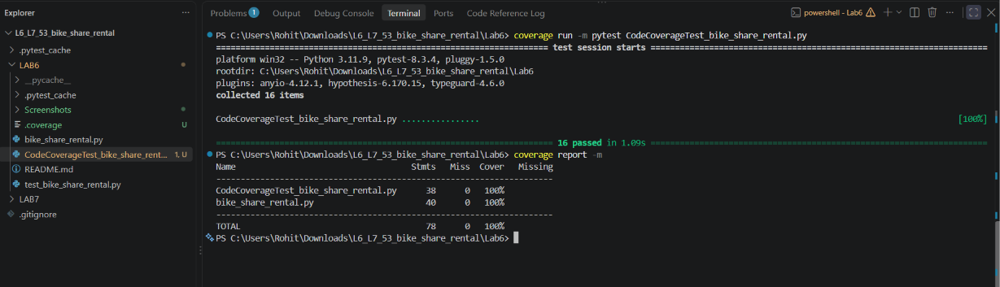
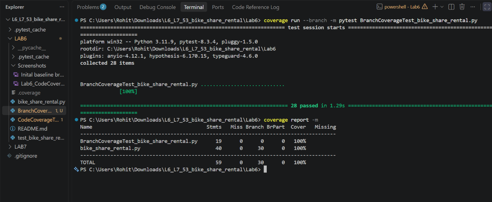
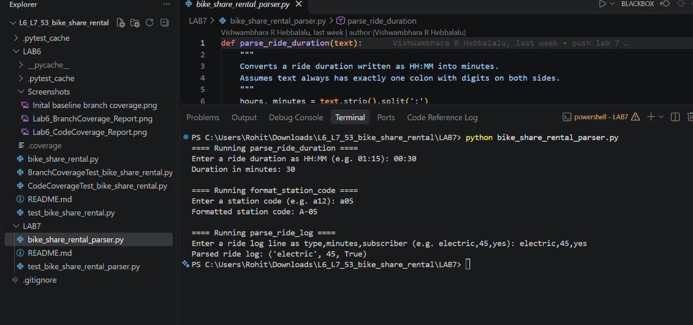
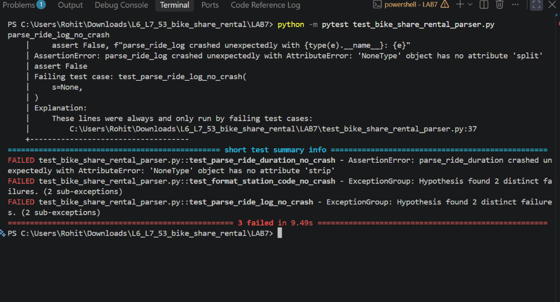
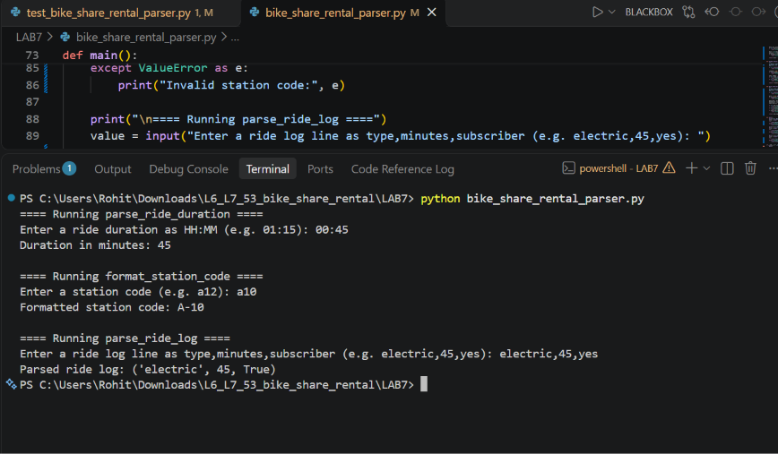
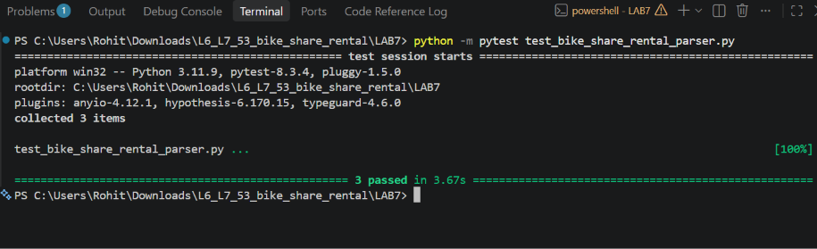

# Bike Share Rental — Software Testing & Verification (Lab 6 & Lab 7)

This repository contains the implementation, automated test suites, coverage reports, and property-based fuzz testing deliverables for the **Bike Share Rental** system across **Lab 6** (Code & Branch Coverage Analysis) and **Lab 7** (Fuzzing for Input Validation Bugs)[cite: 3, 5, 16].

---

## Repository Structure

```text
L6_L7_53_bike_share_rental/
├── LAB6/
│   ├── bike_share_rental.py                    # Core rental pricing, dock status, and unlock logic
│   ├── test_bike_share_rental.py               # Initial baseline unit tests
│   ├── CodeCoverageTest_bike_share_rental.py   # Expanded test suite achieving 100% line coverage
│   ├── BranchCoverageTest_bike_share_rental.py # Expanded test suite achieving 100% branch coverage
│   ├── Screenshots/
│   │   ├── Inital baseline branch coverage.png
│   │   ├── Lab6_CodeCoverage_Report.png
│   │   └── Lab6_BranchCoverage_Report.png
│   └── README.md
├── LAB7/
│   ├── bike_share_rental_parser.py             # Hardened input parser for durations, station codes, and ride logs
│   ├── test_bike_share_rental_parser.py        # Hypothesis property-based fuzz test suite
│   ├── Lab7_FuzzTesting_Report.pdf             # Execution report with terminal screenshots
│   ├── Screenshots/
│   │   ├── Lab7_1_Buggy_App_Run.png
│   │   ├── Lab7_2_Fuzz_Tests_Failing.png
│   │   ├── Lab7_3_Fixed_App_Run.png
│   │   └── Lab7_4_Fuzz_Tests_Passing.png
│   └── README.md
└── README.md
```

---

## Prerequisites & Setup

Install all required testing and analysis libraries:

```bash
pip install pytest coverage hypothesis
```

---

## Lab 6: Code and Branch Coverage Analysis

### Objective
Measure, analyze, and improve line (statement) and branch test coverage for `bike_share_rental.py` using `pytest` and `coverage.py`[cite: 5, 12].

### Execution Commands

**1. Line Coverage Analysis**
```bash
cd LAB6
coverage run -m pytest CodeCoverageTest_bike_share_rental.py
coverage report -m
```

**2. Branch Coverage Analysis**
```bash
cd LAB6
coverage run --branch -m pytest BranchCoverageTest_bike_share_rental.py
coverage report -m
```

### Coverage Results Summary

| Test Suite | Target Metric | Statements | Missing | Branches | Partial | `bike_share_rental.py` Coverage |
| :--- | :--- | :---: | :---: | :---: | :---: | :---: |
| `test_bike_share_rental.py` (Baseline) | Line Coverage | 40 | 20 | — | — | 50% |
| `CodeCoverageTest_bike_share_rental.py` | Line Coverage | 40 | 0 | — | — | **100%** |
| `BranchCoverageTest_bike_share_rental.py` | Branch Coverage | 40 | 0 | 26 | 0 | **100%** |

### Lab 6 Execution Screenshots

#### 1. Baseline Coverage Analysis
Running `coverage` on the initial `test_bike_share_rental.py` yielded **50% line coverage** (20 out of 40 statements missed across `ride_cost`, `dock_status`, and `can_unlock`) and uncovered conditional branches.


#### 2. Code Coverage Analysis (100% Line Coverage)
`CodeCoverageTest_bike_share_rental.py` exercises every executable statement, covering invalid bike types, invalid durations, subscriber discounts, long-ride surcharges, dock capacity thresholds, and age-based unlock rules.



#### 3. Branch Coverage Analysis (100% Branch Coverage)
`BranchCoverageTest_bike_share_rental.py` uses parameterized boundary and compound boolean tests to verify that every `if`, `elif`, and short-circuiting `and`/`or` condition evaluates to both `True` and `False`.



---

## Lab 7: Fuzzing for Input Validation Bugs

### Objective
Use property-based fuzz testing with the `Hypothesis` library to uncover edge-case input crashes in `bike_share_rental_parser.py` and harden all parsing functions using defensive programming[cite: 1, 10].

### Execution Commands

**1. Run the Parser Application**
```bash
cd LAB7
python bike_share_rental_parser.py
```

**2. Run Hypothesis Fuzz Tests**
```bash
cd LAB7
python -m pytest test_bike_share_rental_parser.py
```

### Bugs Discovered & Fixes Applied

| Function | Vulnerabilities Exposed by Fuzzing | Defensive Fix Implemented |
| :--- | :--- | :--- |
| `parse_ride_duration(text)` | Crashed with `AttributeError` on `None`; `ValueError` on missing/multiple colons or non-numeric input; accepted negative values or minutes >= 60. | Enforced `str` type check, exact `HH:MM` colon split, ASCII digit validation, and `0 <= minutes < 60` bounds, raising `ValueError` on invalid input. |
| `format_station_code(code)` | Crashed with `AttributeError` on `None` and `IndexError` on empty/whitespace strings; accepted invalid single-character or non-numeric codes. | Validated `str` type, minimum length of 2, ASCII alphabetic zone prefix, and ASCII numeric suffix before formatting as `ZONE-NUMBER`. |
| `parse_ride_log(line)` | Crashed with `AttributeError` on `None`, `IndexError` on missing fields, and `ValueError` on non-integer minutes; ignored extra fields or invalid flags. | Verified `str` type, exact 3 comma-separated fields, non-empty `bike_type`, non-negative integer `minutes`, and strict `'yes'`/`'no'` subscriber values. |

### Lab 7 Execution Screenshots

#### Step 1: Initial Run of Buggy Application
Running `python bike_share_rental_parser.py` with well-formed inputs (`00:30`, `a05`, `electric,45,yes`) succeeded, masking underlying input-validation vulnerabilities[cite: 16].



#### Step 2: Hypothesis Fuzz Testing Exposes Failures
Running `python -m pytest test_bike_share_rental_parser.py` against the original script failed all 3 tests (`3 failed in 9.49s`), uncovering unhandled `AttributeError` on `None`, `IndexError` on empty strings, and `ValueError` on malformed delimiters[cite: 15].



#### Step 3: Verification of Hardened Application
After implementing strict type, format, and boundary checks alongside `try/except ValueError` handling in `main()`, running `python bike_share_rental_parser.py` processed inputs safely without unhandled exceptions[cite: 14].



#### Step 4: Hypothesis Fuzz Tests Passing on Fixed Code
Re-running `python -m pytest test_bike_share_rental_parser.py` against the hardened parser passed all property-based fuzz checks (`3 passed in 3.67s`)[cite: 13].


